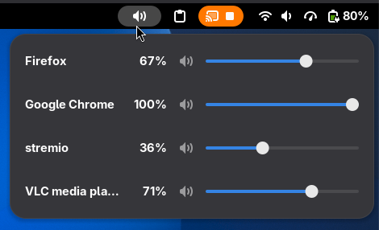

<p align="center">
  
</p>

# App Volume Control

A GNOME Shell extension for controlling the volume of individual applications from the top-panel system menu.


## Preview



## Installation

### From the GNOME Extensions website (Recommended)

<a href="https://extensions.gnome.org/extension/11472/app-volume-control/">
  
</a>

### Manual installation

1. Clone the repository:

   ```bash
   git clone https://github.com/aunchagaonkar/gnome-app-volume-control.git
   cd gnome-app-volume-control
   ```

2. Create the local GNOME Shell extensions directory if it does not already exist:

   ```bash
   mkdir -p ~/.local/share/gnome-shell/extensions/app-volume-control@aunchagaonkar.github.io
   ```

3. Copy the extension files into the directory:

   ```bash
   cp extension.js metadata.json stylesheet.css \
     ~/.local/share/gnome-shell/extensions/app-volume-control@aunchagaonkar.github.io/
   ```

4. Enable the extension:

   ```bash
   gnome-extensions enable app-volume-control@aunchagaonkar.github.io
   ```

You may need to log out and back in, before the extension appears in the top panel.

## Contributing

Contributions, bug reports, and feature requests are welcome. When opening an issue, please include:

- GNOME Shell version
- Distribution and version
- Audio backend, if known (PipeWire or PulseAudio)
- Steps to reproduce the issue
- Relevant GNOME Shell log output

## License

[GNU GPL, version 3 or later](LICENSE).

## Support the project

If this extension is useful to you, consider supporting its development through [GitHub Sponsors](https://github.com/sponsors/aunchagaonkar) or [PayPal](https://www.paypal.com/paypalme/aunchagaonkar).
